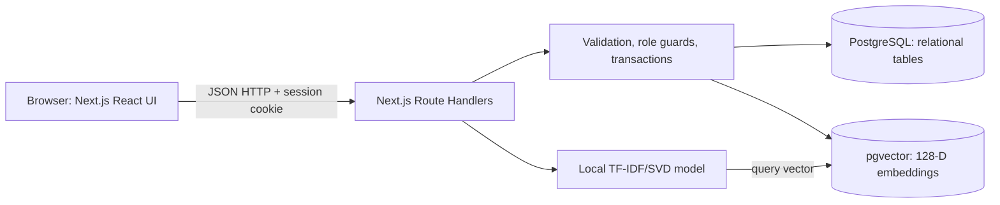
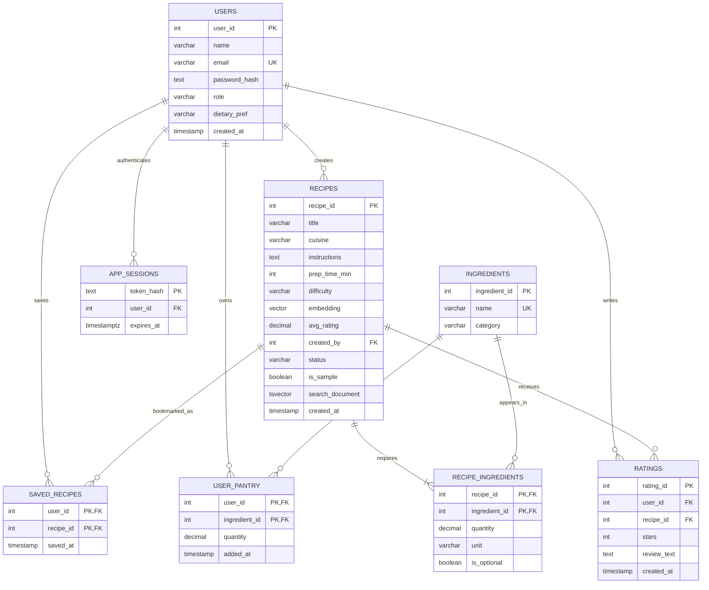

# PantryChef — DBMS Level 3 project

## Problem statement and motivation

People frequently have ingredients at home but do not know which meals they can
make. PantryChef ranks dishes by their required-ingredient coverage, reveals what
is missing, supports text/semantic cravings, and preserves personal pantries and
cookbooks. Matching, semantic retrieval, rating consistency, and moderation go
beyond a simple CRUD application.

## Objectives and scope

Provide a functional Next.js interface backed by PostgreSQL and pgvector;
demonstrate relational integrity and at least four advanced database concepts;
make search useful with ingredient coverage and dietary/cuisine filters; enforce
Regular User and Admin authorization. This is a local teaching/demo application.
The collection is mostly synthetic. It does not claim a licensed corpus of
100,000 unique real recipes, nutritional analysis, allergy certification, or
quantity-aware cooking readiness.

## Functional requirements

Visitors browse recipes, enter/remove ingredients, view requirements and
instructions, and use pantry, keyword, semantic, cuisine, and dietary search.
Regular users register/sign in/out, save/clear pantries, save/unsave recipes,
create/update/delete their own ratings, and submit recipes for review.
Admins inspect dashboards, approve/reject submissions, add published recipes,
and delete recipe records with cascading dependent-row cleanup.

## Guideline mapping

| Guideline | Implementation / evidence |
| --- | --- |
| SQL + a second database paradigm | PostgreSQL relational data + pgvector embeddings |
| ER diagram and relational design | Diagram below, schema/data dictionary, `database/schema.sql` |
| CREATE, ALTER, DROP, constraints | Original DDL, incremental app DDL, DROP in original fresh-schema script and transactional temporary load-test tables |
| INSERT / UPDATE / DELETE / SELECT | Accounts, pantry replacement, recipe creation/moderation/deletion, saves, ratings, and search |
| JOIN / aggregates / GROUP BY / HAVING / subqueries | `pantry_match`, original demo queries, `cuisine_summary`, rating trigger |
| At least four advanced concepts | Transactions, view, stored function, trigger, indexes, full-text, vector similarity (seven) |
| Next.js web interface and backend integration | App Router React UI + Route Handlers + node-postgres |
| Authentication and at least two roles | Password hashing, server sessions, API guards and PostgreSQL RLS policies |
| Validation / integrity | FK/PK/UNIQUE/CHECK/NOT NULL plus API shape and bounds checks |
| Environment-based configuration | `.env.local`, ignored by Git; `.env.example` contains placeholders |
| Documentation / tests / screenshots | This document, README, TESTING, QUERY-PLANS, screenshots directory |
| Git / GitHub and team contributions | Extracted source tracked in DarkTJ7/DBMS-MINI-PROJECT; genuine individual work still required |
| Two-member approved team | Tarun Jagan and Tanishk Gowda named; instructor approval remains student-supplied |

## System architecture



The backend is part of the Next.js server; no separate Python HTTP server is
required. Python trains the local LSA model during setup. Node embeds queries
using the exported vocabulary, IDF weights, and SVD components. The server keeps
database credentials off the browser. WSL scripts are only a local Windows
deployment convenience.

## Database choices and vector model

SQL suits normalized ingredients, ownership, ratings, relationships, and
transactions. pgvector suits searching text descriptions by approximate semantic
similarity. Both paradigms share transactionally consistent recipe IDs without
duplicating a separate recipe store.

The training text concatenates title, instructions, and ingredient names. TF-IDF
uses up to 4,000 terms with English stop words removed. TruncatedSVD reduces to
128 dimensions (zero-padding if a smaller training vocabulary requires it).
Vectors are normalized and stored in `recipes.embedding VECTOR(128)`. Query
text uses the same fitted model. Cosine distance is `<=>`; similarity is `1 -
distance`. `idx_recipes_embedding` is an IVFFlat cosine index with 50 lists.
Search ranks by cosine distance; relational filters can alter the planner's
chosen access path. Small tables may justifiably use sequential scans.

The original dump has 900 embeddings but no exported model. App setup therefore
retrains and rewrites those vectors before exporting `.generated/lsa.json`.
Starter recipes and user submissions use the same exported model. This baseline
has limited synonym understanding and cannot embed words absent from its vocabulary.
Unknown-vocabulary queries return a useful validation error rather than a zero vector.

## ER diagram



## Relational schema / data dictionary

| Relation | Key | Other attributes | Integrity |
| --- | --- | --- | --- |
| Users | user_id SERIAL PK | name VARCHAR(100), email VARCHAR(150), password_hash TEXT, role VARCHAR(10), dietary_pref VARCHAR(50), created_at TIMESTAMP | Name/email/hash required; email unique, unique lower(email); role required and user/admin |
| Ingredients | ingredient_id SERIAL PK | name VARCHAR(100), category VARCHAR(50) | Name required and unique |
| Recipes | recipe_id SERIAL PK | title VARCHAR(200), cuisine VARCHAR(50), instructions TEXT, prep_time_min INT, difficulty VARCHAR(10), embedding VECTOR(128), avg_rating DECIMAL(3,2), created_by FK Users, status VARCHAR(10), is_sample BOOL, search_document TSVECTOR, created_at TIMESTAMP | Nonempty title/instructions; positive time; Easy/Medium/Hard; approved/pending/rejected; creator delete sets NULL |
| RecipeIngredients | (recipe_id, ingredient_id) composite PK | quantity DECIMAL(6,2), unit VARCHAR(20), is_optional BOOL | FKs cascade; positive non-NULL application quantities; optional flag required |
| UserPantry | (user_id, ingredient_id) composite PK | quantity DECIMAL(6,2), added_at TIMESTAMP | FKs cascade; positive quantity when supplied |
| Ratings | rating_id SERIAL PK | user_id FK, recipe_id FK, stars INT, review_text TEXT, created_at TIMESTAMP | Unique user/recipe; required stars between 1 and 5; cascade FKs |
| SavedRecipes | (user_id, recipe_id) composite PK | saved_at TIMESTAMP | Cascade FKs; duplicate saves are idempotent |
| AppSessions | token_hash TEXT PK | user_id FK, expires_at TIMESTAMPTZ | Cascade FK; 64-character SHA-256 hex digest |

FK pairs implement the recipe/ingredient, user/ingredient, and user/recipe
many-to-many relationships. Ingredient matching ignores optional links, and
zero-required recipes cannot report 100% (NULLIF guards division by zero).
API submission requires at least one required ingredient and rejects duplicate
ingredient links before entering the transaction.

## Advanced database features and important queries

**Stored function:** `pantry_match(integer[])` ranks required coverage through
conditional aggregates and candidate lookup. The original
`get_pantry_match(user_id)` remains available as a historical demo; it counts
optional ingredients, so the web app intentionally uses the new function.

```sql
SELECT * FROM pantry_match(ARRAY[1,16,17,18,36])
ORDER BY match_pct DESC NULLS LAST LIMIT 24;
```

**Full-text:** weighted generated TSVECTOR column (title A, instructions B) with
GIN index. `websearch_to_tsquery` accepts natural keyword expressions and
`ts_rank` orders keyword matches.

```sql
SELECT recipe_id,title FROM recipes
WHERE search_document @@ websearch_to_tsquery('english','chicken rice');
```

**Vector:** normalized 128-D embeddings and IVFFlat cosine index. The API embeds
the user's craving with the same model before using `<=>`.

```sql
SELECT recipe_id,title FROM recipes
ORDER BY embedding <=> (SELECT embedding FROM recipes
 WHERE embedding IS NOT NULL LIMIT 1) LIMIT 24;
```

**Trigger:** inserts, updates, and deletes on Ratings recompute average stars.
The trigger also recomputes the old recipe if an update moves a rating.

**Transactions:** creating a recipe and its ingredient links is all-or-nothing.
Pantry replacement takes a per-user transaction advisory lock, deletes old entries, and inserts new
entries in a single transaction to prevent concurrent lost/duplicate writes.
Errors roll back. The inherited procedure demonstrates CALL and transaction
semantics, but the backend owns its transaction boundary.

**View:** `cuisine_summary` supplies grouped counts and average ratings for
admin dashboards. **Indexes:** FK ingredient lookup, ratings by recipe, cuisine,
status, GIN full-text, IVFFlat vectors, and sessions by user/expiry.

Measured plans, including whether the optimizer selected an index, are in
`QUERY-PLANS.md`. No benchmark claims are inferred from index existence alone.

## Security and integrity

All request-supplied SQL values use parameters. Passwords use salted scrypt;
placeholder seed hashes cannot authenticate. Random opaque session tokens are
stored only as SHA-256 digests in the database. Cookies are HttpOnly/SameSite=Lax
and Secure in production. Mutations validate request origins. Registration
always creates `user` even if a forged body requests `admin`. Backend guards
check roles on every privileged action. Login endpoints have a best-effort
single-process rate limit; scaled production requires a shared store.

DATABASE_URL and setup credentials use ignored environment configuration. The
application role owns only this database's project objects and is not superuser.
Client responses contain no password hashes, session digests, or connection URLs.
FK/UNIQUE/CHECK/NOT NULL constraints protect integrity independently of UI checks.

## Demonstration sequence

1. Explain the pantry problem and relationships in the ER diagram.
2. Enter mushroom, garlic, butter, pasta, cream; find two 100% starter matches.
3. Remove cream; the pasta recipe displays cream as missing while the mushroom
   side remains ready. Show Ready to cook only and cuisine/diet filters.
4. Enter a craving in Keyword and Meaning modes; discuss the different retrieval.
5. Create a regular account, save pantry and cookbook, add/update/delete a rating.
6. Submit a recipe. Show it is pending and absent from visitor search.
7. Sign in as admin, review/approve it, then show it in public search.
8. Show constraints, stored function, trigger, transaction test, view, and measured
   query plans. Discuss small-table sequential scans and synthetic load testing.
9. Show tests and Git history with each member's actual contributions.

## Proposed team responsibilities and actual contribution evidence

| Member | Database contribution | Application contribution |
| --- | --- | --- |
| Tarun Jagan (Member 1) | Relational modeling, constraints, pantry function, query plans | Pantry entry, filters, recipe results/details |
| Tanishk Gowda (Member 2) | Embeddings/indexes, rating trigger, transaction/session design | Authentication, cookbook, ratings, submissions/admin |

Both members should review the complete integration, implement their own changes,
write tests, and make genuine commits. This is a proposed division, not a record
of work performed by students. Obtain instructor approval for the two-member team
and title uniqueness. This project was developed with Codex assistance; review,
understand, and disclose that assistance according to your course rules. The
documentation does not certify originality approval or fabricate contribution
history. The public repository is https://github.com/DarkTJ7/DBMS-MINI-PROJECT. A collaborator invitation was issued to tanishkgowda; acceptance is separate from contribution evidence.

## Screenshots, testing, conclusion, enhancements

Screenshots of desktop, recipe details, and mobile are in `screenshots/`.
Testing results and known limits are in `TESTING.md`. PantryChef connects a
usable kitchen workflow with relational and vector retrieval and consistency.
Future work: licensed real recipe ingestion, better semantic models, quantity
and unit conversion, structured substitutions, nutritional/allergen metadata,
reset-password/email verification, and production deployment/observability.


## Database-enforced permissions (15 October 2026)

`database/access.sql` enables PostgreSQL row-level security on recipes,
recipe_ingredients, users, user_pantry, saved_recipes and ratings. Ordinary API
queries connect using `pantrychef_runtime`, which has no superuser, BYPASSRLS,
role-creation or database-creation privileges, and does not own application tables.
The runtime account cannot read password hashes/session records, promote users,
change schema, or assume the owner role. It has no table writes on users/sessions.

Each request gets an AsyncLocalStorage context containing only the SHA-256 digest
of its opaque session cookie. Every SQL transaction sets that digest with
transaction-local `set_config`; it is cleared on commit/rollback and cannot leak
through the connection pool. SECURITY DEFINER helpers, with a fixed search path,
resolve the digest against non-expired database sessions and derive the user's
role from Users. No role or user ID supplied in JSON is trusted. Invalid,
expired and revoked digests have visitor access.

Visitors see approved recipes. Regular users see their own pending recipes and
can create pending submissions; only admins may edit, moderate or delete recipes.
Pantries and saved recipes belong to the session user. Ratings can be read with
visible recipes; only their author may write them. Ingredient-link policies follow
recipe visibility. Public profile views contain names/IDs only; the cuisine view
uses invoker rights. A narrowly scoped owner-rights trigger maintains rating averages.

The private owner connection remains the trust boundary for account registration,
password verification, session issuance/revocation and maintenance. It is never
selected for ordinary request queries. This does not defend against compromised
server code or stolen owner credentials. Both connection URLs are server-only.
Direct runtime SQL denial/isolation tests are in `tests/database-access.test.mjs`.

## Recipe editing and vector Read / Update / Delete

Sign in as admin, open a recipe, and click **Edit recipe**. The prefilled form
supports title, instructions, cuisine, difficulty, cooking time and ingredient
quantities/units/optional flags. `PUT /api/recipes/:id` validates all fields,
embeds the updated title + instructions + ingredient names, and updates the recipe
and replaces its ingredient links in a single transaction. The generated full-text
column updates with the text. Moderation status and original creator are preserved.

Read: Meaning search uses cosine distance on persisted embeddings. Update: editing
regenerates the stored 128-D vector using the fitted local LSA model. Delete: admin
deletion removes the vector-bearing row, ingredient links, ratings and saves; the
recipe disappears from details/search. Integration tests compare vectors before
and after an edit, check cosine distance against the expected new embedding, reject
invalid/unauthorized updates, and verify cascading deletion and absent search hits.

See `RUBRIC-CHECKLIST.md` for the 50-mark rubric mapping and `VIVA-GUIDE.md` for a
practice/demo sequence. Those documents do not certify student authorship or marks.
